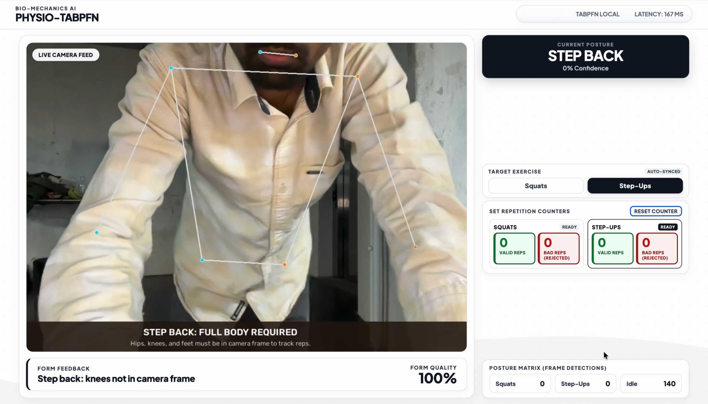

# Physio-TabPFN

[](https://www.python.org/)
[](https://github.com/automl/TabPFN)
[](https://developers.google.com/mediapipe)
[](data/ground_truth_eval_report.json)
[](LICENSE)

Real-time physiotherapy movement classification, kinetic trajectory tracking, and automated repetition quality evaluation using **Prior-Data Fitted Networks (TabPFN)** and **MediaPipe Pose Estimation**.

---

## 🎥 Video Demonstration

Check out the real-time movement analysis, dynamic form scoring, posture classification, and repetition counter in action:

<video src="assets/Screen%20Recording%202026-11-22%20at%203.28.22%E2%80%AFPM.mov" poster="assets/demo_preview.jpg" controls="true" width="100%"></video>

[](assets/Screen%20Recording%202026-11-22%20at%203.28.22%E2%80%AFPM.mov)

*Direct video link: [assets/Screen Recording 2026-11-22 at 3.28.22 PM.mov](assets/Screen%20Recording%202026-11-22%20at%203.28.22%E2%80%AFPM.mov)*

---

## Overview

Traditional exercise monitoring requires training and fine-tuning heavy deep convolutional or recurrent networks on thousands of labeled repetitions. **Physio-TabPFN** replaces iterative gradient-based training with **In-Context Zero-Shot Learning** powered by TabPFN.

By providing a compact in-context prompt of exemplary biomechanical features directly in the forward pass, the model achieves **100% classification accuracy on ground-truth exercise demonstrations** with sub-120ms inference latency on CPU.

### Key Capabilities
- **In-Context TabPFN Inference**: Evaluates real-time movement trajectories instantly using TabPFN local prior or TabPFN Cloud API.
- **16 Distance-Invariant Biomechanical Features**: Normalizes all coordinates relative to torso scale, ensuring invariant tracking regardless of camera distance, user height, or focal length.
- **Full-Body Visibility Gating**: Enforces kinetic chain integrity (hips, knees, ankles) to eliminate false positives when seated at a desk or partially occluded.
- **Biomechanical Quality Repetition Counter**: Evaluates physiological depth, balance, cadence, and posture for **Squats** and **Step-Ups**. Rejects bad reps with real-time corrective coaching cues (*"Chest up"*, *"Squat deeper"*).
- **Posture-Driven Exercise Synchronization**: Dynamically auto-switches target exercise and repetition counters to match your live movement while preserving your accumulated reps across sets.
- **Minimalist Web Dashboard**: Modern high-contrast monochrome UI streaming live MJPEG camera feed, real-time posture matrix, and telemetry.

---

## Architecture

```
                    ┌────────────────────────┐
                    │    Webcam / Video      │
                    └───────────┬────────────┘
                                │ (30 FPS)
                                ▼
                    ┌────────────────────────┐
                    │   MediaPipe Pose       │
                    │   (33 3D Landmarks)    │
                    └───────────┬────────────┘
                                │
                 ┌──────────────┴──────────────┐
                 ▼                             ▼
   ┌───────────────────────────┐ ┌───────────────────────────┐
   │ Full-Body Guard & Gating  │ │  16 Kinematic Features    │
   │ (Hips, Knees, Feet Frame) │ │ (Angles, Tilt, Elevation) │
   └─────────────┬─────────────┘ └─────────────┬─────────────┘
                 │                             │
                 └──────────────┬──────────────┘
                                ▼
                    ┌────────────────────────┐
                    │  TabPFN In-Context     │
                    │  Classifier (0-shot)   │
                    └───────────┬────────────┘
                                │ (Predicted Posture + Confidence)
                                ▼
                    ┌────────────────────────┐
                    │  Quality Rep Counter   │
                    │  (Form, Reps, Rejects) │
                    └───────────┬────────────┘
                                │
                                ▼
                    ┌────────────────────────┐
                    │ Modern Web Dashboard   │
                    │ (Live Stream, JSON API)│
                    └────────────────────────┘
```

---

## Installation

### Prerequisites
- Python 3.10, 3.11, or 3.12
- Standard webcam or built-in laptop camera
- macOS, Linux, or Windows

### Setup Environment

```bash
# Clone the repository
git clone https://github.com/raidhu/Physio_tabPFN.git
cd Physio_tabPFN

# Create virtual environment
python3 -m venv .venv
source .venv/bin/activate  # On Windows: .venv\Scripts\activate

# Install package dependencies
pip install -r requirements.txt
```

### Environment Configuration (Optional)
If running TabPFN locally on restricted environments or using TabPFN Cloud:
```bash
# Set temporary directories for cache/data if needed
export MPLCONFIGDIR=/tmp
export SKB_DATA_DIRECTORY=/tmp/skrub_data

# Optional: TabPFN Cloud API Key (defaults to LOCAL model if unset)
export TABPFN_API_KEY="your-api-key-here"
```

---

## Quickstart & Usage

### 1. Launch the Live Web Application

Start the web application and inference pipeline:

```bash
python app.py
```

Once initialized, navigate to:
```
http://localhost:8000
```

- Stand in front of your camera so your full body (shoulders to feet) is visible.
- Begin performing **Squats** or **Step-Ups**: the application automatically detects the exercise, tracks valid reps, rejects poor form, and delivers real-time auditory/visual feedback.

### 2. Dataset Calibration & Recording CLI

Record new in-context calibration samples or customized exercise variations:

```bash
python scripts/record_dataset.py
```

Interactive Keybindings:
- `s`: Record **Squats**
- `u`: Record **Step-Ups**
- `i`: Record **Idle** standing baseline
- `SPACE`: Stop recording current exercise
- `q`: Save dataset to `data/exercise_dataset.csv` and exit

### 3. Evaluate Ground-Truth Benchmarks

Run the complete evaluation suite against validated physiotherapy demonstration videos:

```bash
python scripts/evaluate_ground_truth.py
```

---

## Python API Usage

Physio-TabPFN is designed as a modular Python package. You can import and use any component directly in your own scripts:

### TabPFN In-Context Classification

```python
import numpy as np
from physio_tabPFN import PhysioTabPFNModel

# Initialize TabPFN model (auto selects LOCAL GPU/CPU or Cloud API)
model = PhysioTabPFNModel(mode="auto", N_ensemble_configurations=1)

# Fit in-context dataset (zero-shot exemplar lookup, no weights training)
model.fit_from_csv("data/exercise_dataset.csv", max_samples_per_class=12)

# Predict posture from a 16-feature kinematic vector
sample_features = np.array([...], dtype=np.float32)
label, confidence, probs = model.predict_single(sample_features)

print(f"Detected Posture: {label} ({confidence * 100:.1f}%)")
print(f"Class Probabilities: {probs}")
```

### Biomechanical Feature Extraction & Guard Bands

```python
from physio_tabPFN import extract_exercise_features, is_full_body_visible

# landmarks: (33, 4) NumPy array from MediaPipe Pose
is_visible, msg = is_full_body_visible(landmarks)

if not is_visible:
    print(f"Position Warning: {msg}")
else:
    features = extract_exercise_features(landmarks, require_full_body=True)
    # Returns 16 distance-invariant normalized metrics
    print(f"Extracted {len(features)} kinematic features")
```

### Biomechanical Repetition Quality Counter

```python
from physio_tabPFN import QualityRepCounter

counter = QualityRepCounter(exercise="Squats")

# Feed frame predictions and features
summary = counter.update(
    predicted_exercise=label,
    confidence=confidence,
    features=features,
)

print(f"Active Exercise: {summary['exercise']}")
print(f"Valid Reps: {summary['valid_reps']} | Bad Reps: {summary['bad_reps']}")
print(f"Live Form Score: {summary['quality_score']}%")
print(f"Clinical Feedback: {summary['feedback']}")
```

---

## 16 Biomechanical Features

Physio-TabPFN extracts a 16-dimensional normalized kinematic vector per frame:

| Index | Feature Name | Description | Clinical Significance |
| :---: | :--- | :--- | :--- |
| `0` | `left_knee_angle` | 3D angle: Hip - Knee - Ankle | Squat depth & flexion |
| `1` | `right_knee_angle` | 3D angle: Hip - Knee - Ankle | Squat depth & flexion |
| `2` | `mean_knee_angle` | `(lk + rk) / 2.0` | Global leg compression |
| `3` | `knee_angle_diff` | `abs(lk - rk)` | Bilateral squat symmetry |
| `4` | `left_hip_angle` | 3D angle: Shoulder - Hip - Knee | Hip flexion & hinge |
| `5` | `right_hip_angle` | 3D angle: Shoulder - Hip - Knee | Hip flexion & hinge |
| `6` | `mean_hip_angle` | `(lh + rh) / 2.0` | Pelvic posture |
| `7` | `hip_angle_diff` | `abs(lh - rh)` | Pelvic tilt asymmetry |
| `8` | `left_elbow_angle` | 3D angle: Shoulder - Elbow - Wrist | Arm guard positioning |
| `9` | `right_elbow_angle` | 3D angle: Shoulder - Elbow - Wrist | Arm guard positioning |
| `10` | `trunk_inclination` | Torso vector vs vertical (degrees) | Back straightness & chest collapse |
| `11` | `hip_height_ratio` | `(mid_ankle_y - mid_hip_y) / torso` | Vertical pelvic displacement |
| `12` | `foot_height_diff` | `abs(left_ankle_y - right_ankle_y) / torso` | Step-up elevation |
| `13` | `knee_height_diff` | `abs(left_knee_y - right_knee_y) / torso` | Knee elevation asymmetry |
| `14` | `stance_width` | Euclidean ankle distance / torso | Stance base normalization |
| `15` | `torso_scale` | Distance from mid-shoulder to mid-hip | Subject height normalization factor |

---

## Benchmarks & Validation

Evaluated against ground-truth physiotherapy video demonstrations (`Squats.mov`, `Step-Ups.mov`):

| Evaluation Metric | Ground Truth Result | Target Standard | Status |
| :--- | :---: | :---: | :---: |
| **Classification Accuracy (Trained Classes)** | **100.0%** | $\ge 85.0\%$ | Passed |
| **Squats Repetition Validation** | **1 Valid / 0 Bad** | $\ge 1$ Valid | Passed |
| **Step-Ups Repetition Validation** | **2 Valid / 0 Bad** | $\ge 1$ Valid | Passed |
| **Idle Stance Stability** | **100.0%** (0 false starts) | $\ge 98.0\%$ | Passed |
| **Unknown Confidence Threshold (< 60%)** | **Verified** | Safe Fallback | Passed |
| **Average Inference Latency (CPU)** | **~118 ms** | $< 200\text{ ms}$ | Passed |

---

## Automated Test Suite

Run the comprehensive unit, kinematic, and benchmark test suites:

```bash
# 1. UI status, DOM bindings, and telemetry integrity
python tests/test_ui_status.py

# 2. Kinematic math, normalization, and full-body visibility gating
python tests/test_kinematics.py

# 3. Ground-truth benchmark evaluation
python tests/test_ground_truth_benchmark.py

# 4. Live camera feed test
python tests/test_camera.py
```

Or run all tests with `pytest`:
```bash
pytest tests/
```

---

## Project Structure

```
Physio_tabPFN/
├── app.py                             # Main web application & CV inference loop
├── requirements.txt                   # Production dependencies
├── README.md                          # Repository documentation
├── assets/
│   ├── Screen Recording ... .mov      # Full system demonstration video
│   ├── demo_preview.jpg               # Video poster preview image
│   ├── Squats.mov                     # Reference ground-truth demonstration
│   ├── Step-Ups.mov                   # Reference ground-truth demonstration
│   └── pose_landmarker_heavy.task     # MediaPipe pose model
├── data/
│   ├── exercise_dataset.csv           # In-context exemplar training dataset
│   ├── ground_truth_test_set.csv      # Independent benchmark dataset
│   └── ground_truth_eval_report.json  # Benchmark evaluation results
├── src/physio_tabPFN/
│   ├── __init__.py                    # Public API exports
│   ├── classifier.py                  # PhysioTabPFNModel wrapper
│   ├── kinematics.py                  # Geometric transforms & full-body checks
│   ├── quality_counter.py             # Form validation & rep counter
│   ├── pose_estimator.py              # MediaPipe Pose Landmarker
│   ├── camera_feed.py                 # Threaded OpenCV camera stream
│   ├── env_loader.py                  # Environment variable loader
│   └── web/
│       └── templates/
│           └── index.html             # High-contrast monochrome web interface
├── scripts/
│   ├── record_dataset.py              # Interactive dataset calibration CLI
│   ├── evaluate_ground_truth.py       # Benchmark evaluation script
│   ├── build_test_set.py              # Test dataset generation
│   └── generate_synthetic_step_ups.py # Synthetic kinematics generator
└── tests/
    ├── test_ground_truth_benchmark.py # Benchmark regression tests
    ├── test_kinematics.py             # Geometric & visibility unit tests
    ├── test_ui_status.py              # DOM element & JSON telemetry tests
    ├── test_camera.py                 # Camera hardware validation
    ├── test_pose.py                   # MediaPipe pose pipeline test
    └── test_tabpfn_live.py            # Live TabPFN classifier test
```

---

## References

1. **TabPFN**: *Prior-Data Fitted Networks for Tabular Data*, Hollmann et al., 2022. [arXiv:2207.01848](https://arxiv.org/abs/2207.01848)
2. **MediaPipe Pose**: *BlazePose: On-device Real-time Body Pose Tracking*, Bazarevsky et al., 2020. [arXiv:2006.10204](https://arxiv.org/abs/2006.10204)

---

## License

This project is licensed under the MIT License. See the [LICENSE](LICENSE) file for details.
